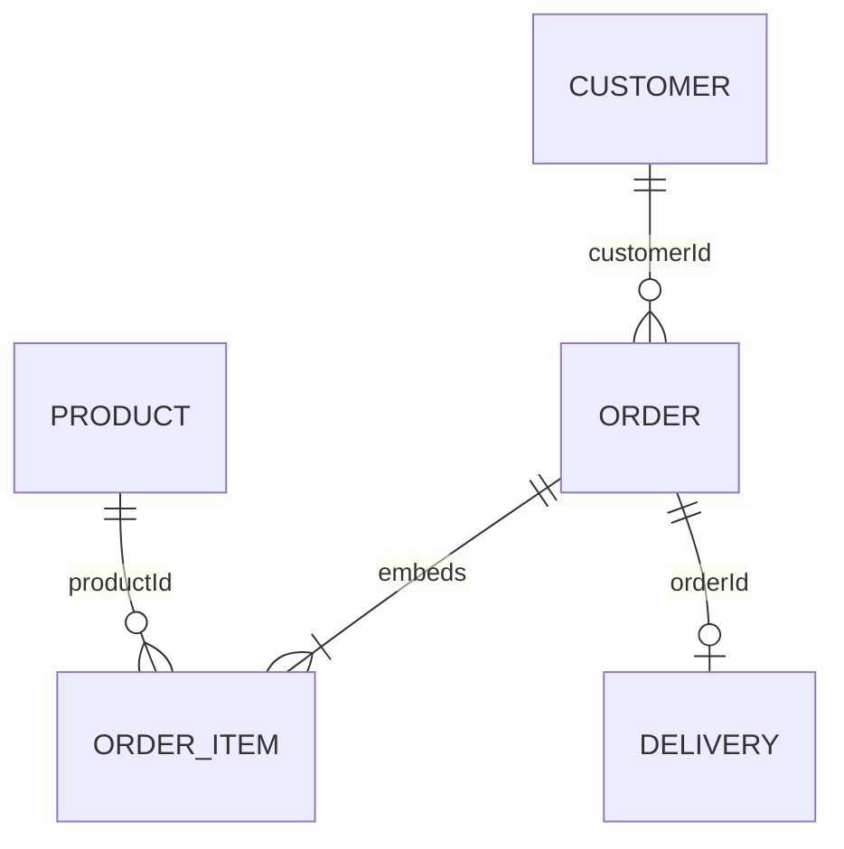

# Thiết kế dữ liệu CouchDB

Một database `qlbanhang`, phân biệt document bằng `type`. `_id` là mã ổn định; `_rev` do CouchDB cấp, bắt buộc khi sửa/xóa, không dùng làm số phiên bản nghiệp vụ. Xung đột 409 yêu cầu tải lại, không tự ghi đè.



| Document | Trường chính | Quy tắc |
|---|---|---|
| customer | name, email, phone, address | tên bắt buộc, email hợp lệ nếu nhập |
| product | name, category, price, quantity, status | giá và số lượng không âm |
| order | customerId, orderDate, status, items[], total, paymentMethod, address | tham chiếu đúng loại, ngày ISO, ít nhất 1 item; tổng tính phía server |
| item nhúng | productId, quantity, price | quantity > 0; price >= 0, giữ giá tại thời điểm đặt |
| delivery | orderId, shipperId, status, pickupDate, expectedDate, address | tham chiếu đơn hợp lệ; quy trình trạng thái do ứng dụng kiểm tra |

Nhúng item vì thường đọc/cập nhật cùng đơn, một document được ghi nguyên tử. Không nhúng khách/sản phẩm đầy đủ vì chúng được dùng chung và có vòng đời riêng; lưu mã tham chiếu và giá lịch sử. Không có join/foreign key hoặc transaction xuyên document tự động như CSDL quan hệ. Ứng dụng phải kiểm tra tham chiếu và xử lý ghi nhiều document có thể thất bại từng phần. Không tự coi danh sách trạng thái rời rạc là một transaction.

```json
{"_id":"p2-order-001","type":"order","customerId":"p2-customer-001","orderDate":"2026-10-01","status":"processing","items":[{"productId":"p2-product-001","quantity":2,"price":10000},{"productId":"p2-product-002","quantity":1,"price":20000}],"total":40000,"paymentMethod":"COD","address":"Địa chỉ mô phỏng"}
```

Chạy `scripts/Seed-Demo.py` qua `With-CouchEnvironment.ps1`: 20 khách, 30 sản phẩm, 30 đơn nhiều dòng/6 trạng thái, 20 giao hàng, tất cả thông tin giả. ID `p2-*` cố định, PUT không `_rev`: 409 giữ nguyên tài liệu có sẵn, không reset dữ liệu đã sửa. Nếu ID cũ đã sai nghiệp vụ, kiểm thử báo FAIL và người vận hành xử lý riêng; không âm thầm ghi đè. Bốn `demo-*` cũ được giữ lại.

Index JSON được khai báo tại `Seed-Demo.py`: type/id; type/status/id; type/customerId/orderDate/id; type/orderDate/id; type/category/price/id; type/price/id; type/total/id; type/orderId/id; type/shipperId/status/id. Chỉ mục phục vụ các prefix tương ứng; điều kiện regex và mảng có thể còn phải lọc trong CouchDB. `_explain` kiểm tra index được chọn, không suy ra mọi điều kiện đều được tăng tốc. Bookmark phải đi cùng selector/sort không đổi.

Nguồn: [Mango API](https://docs.couchdb.org/en/stable/api/database/find.html), [Document API và revision](https://docs.couchdb.org/en/stable/api/document/common.html). Kết quả thực tế xem TEST_RESULTS.md; ảnh Fauxton là minh chứng riêng.
